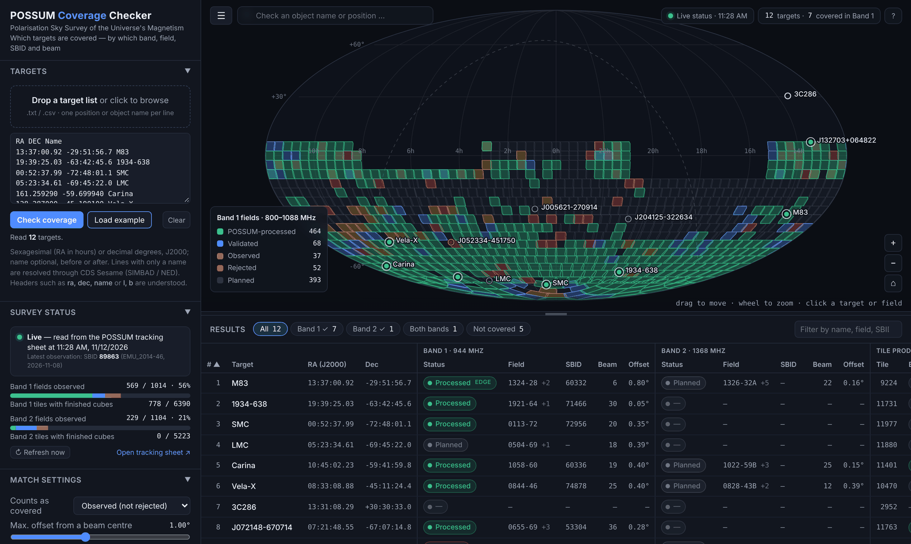

# POSSUM Coverage Checker

**Which of my targets has POSSUM covered — in which band, field, SBID, beam and tile?**

A single-page browser tool for the [Polarisation Sky Survey of the Universe's Magnetism](https://possum-survey.org) (POSSUM). Give it a list of positions or object names and it matches each one against every POSSUM field in both bands, using the survey status read live from the collaboration's tracking sheet each time the page opens.

**Use it now: <https://possum-collaboration.github.io/possum-coverage-checker/>** — nothing to install. Or download `index.html` and open it in a browser; it is the whole application.



## What you get

- **Per target, per band:** survey status (planned → observed → validated → POSSUM-processed, or rejected), the covering field, its SBID, the nearest beam (1–36) and the offset from that beam's centre, with an *edge* flag for targets outside the beam grid.
- **Every covering field**, not only the nearest: overlapping and interleaved (A/B) fields are all listed, each with its three nearest beams, observation and validation dates, and the full observation history including rejected attempts.
- **Tile products:** the HEALPix tile (N<sub>side</sub> 32) containing the target and the state of its mosaic and 3D-pipeline cubes.
- **A sky map** of the survey as it stands today — Mollweide or globe, equatorial or Galactic, observations or tile products, Band 1 or Band 2 — with beam footprints when zoomed in. Click any patch of sky to query it.
- **Live status, visibly.** A green indicator means the status came from the tracking sheet in this session. If the sheet cannot be reached, the page says so and falls back to a dated built-in snapshot; exports record which was used.
- **What changed:** targets whose status has improved since you last checked the same position (in the same browser) are marked *NEW*.
- **Exports:** summary CSV (one row per target), all-matches CSV (target × field × beam), an SBID / beam list for fetching data from CASDA, and a PNG of the map.

## Input

Drop a `.txt` / `.csv` file anywhere on the page, paste into the Targets box, or type into the search box above the map. One target per line:

```text
13:37:00.92 -29:51:56.7 M83          # sexagesimal: RA in hours
161.259290 -59.699940 Carina         # decimal degrees
NGC 253 11.888 -25.288               # name first is fine
13 37 00.9 -29 51 57                 # name is optional
Abell 3627                           # name only: resolved by CDS Sesame (SIMBAD / NED)
```

Commas, tabs or spaces all work. A header row such as `name,ra,dec` or `l,b` selects columns (Galactic input is converted). Coordinates are J2000. See [`examples/`](examples/) and the [user guide](docs/USER_GUIDE.md).

## How coverage is decided

A target is *inside a field* when it lies within a chosen distance (default 1.0°) of one of the field's 36 beam centres; the beam pitch is 0.9°. Targets more than 0.65° from every beam centre are outside the beam grid and are flagged *edge*. A field *counts as covered* when its status is at or above a level you choose (default: observed and not rejected). Both settings are in the side panel, and both are written into every export. Details and caveats are in the [user guide](docs/USER_GUIDE.md#how-coverage-is-decided).

## Data sources and credits

- Survey, tile and observation status: the *POSSUM Pipeline status* sheet maintained by Cameron Van Eck.
- Beam centres for the full survey in both bands: tables by Lerato Sebokolodi (`data/beams/`).
- Builds on `covered_by_POSSUM.py` (Craig Anderson; nearest-beam matching) and `query_status.py` (Erik Osinga; status lookup with SIMBAD name resolution).
- Object names are resolved by the [CDS Sesame](https://cds.unistra.fr/cgi-bin/Sesame) service.

If this tool contributes to a publication, please cite the POSSUM survey description paper and acknowledge the tool (see [`CITATION.cff`](CITATION.cff)).

## Development

```sh
./build.sh                    # src/ -> index.html
./build.sh --data --fetch     # also refresh the offline snapshot from the live sheet
node tests/core.mjs           # parsing, HEALPix, matching (no dependencies)
npm i playwright && node tests/smoke.mjs   # headless end-to-end check
```

See [docs/DEVELOPER.md](docs/DEVELOPER.md). Licensed under the [BSD 3-Clause License](LICENSE).
