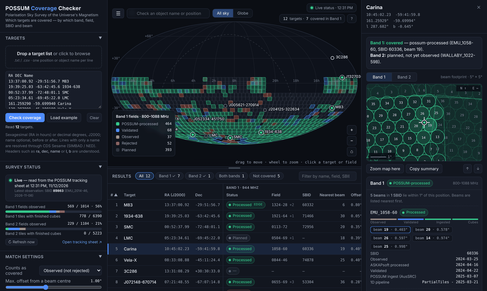
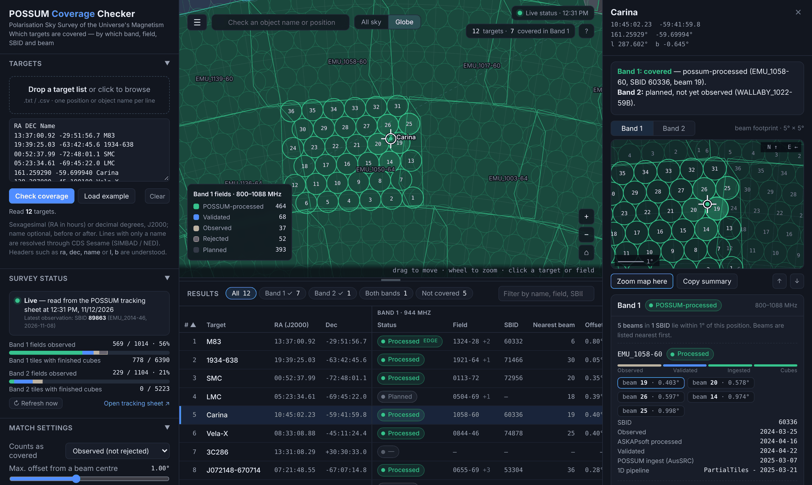
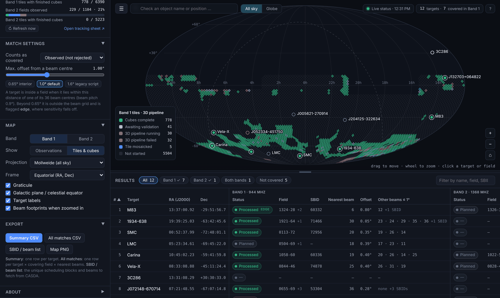

# POSSUM Coverage Checker — user guide

## 1. Open it

Go to <https://possum-collaboration.github.io/possum-coverage-checker/>, or open a downloaded `index.html` in any current browser. On opening, the page reads five tabs of the POSSUM tracking sheet. The indicator at the top right and in the **Survey status** panel shows the result:

| Indicator | Meaning |
|---|---|
| green, "Live status · 14:03" | Status was read from the tracking sheet at that time in this session. |
| amber, "Partly live" | Field status is live, but a secondary tab (tiles or observation history) could not be read and comes from the built-in snapshot. |
| amber, "Stale · snapshot 2026-11-12" | The sheet could not be reached. Results use the snapshot built into the file and may be out of date. |

**Refresh now** re-reads the sheet without reloading the page.

## 2. Give it targets

- **Drop** a text or CSV file anywhere on the page, **paste** into the Targets box, or type one line into the **search box** above the map and press Enter.
- Each line is `RA Dec [name]` or `name RA Dec`. Sexagesimal right ascension is in hours (`13:37:00.9`, `13h37m00.9s`, or `13 37 00.9`); plain numbers are decimal degrees. All coordinates are J2000.
- A line with only a name (`Abell 3627`) is resolved through CDS Sesame. This needs network access; resolved positions are remembered in your browser.
- A header row selects columns by name: `ra`/`dec` (also `raj2000`, `ra_deg`, …), `l`/`b` or `glon`/`glat` for Galactic input, and `name`/`source`/`id`.
- `#` starts a comment. Lines that cannot be read are listed under the Targets box with the reason; nothing is silently dropped.

Your list and settings are kept in the browser, so reopening the page re-checks the same targets against the current survey status.

## 3. Read the results

The table has one row per target and a block of columns per band:

| Column | Meaning |
|---|---|
| Status | The best field covering the target: *Planned*, *Observed* (awaiting validation), *Validated*, *Processed* (ingested by the POSSUM pipeline at AusSRC), or *Rejected* (observed, failed validation, to be re-observed). "—" means no field of that band reaches the position. |
| Field | Field name without the `EMU_` / `WALLABY_` prefix; `+2` means two further fields also cover the target. |
| SBID | ASKAP scheduling block of that field's current observation. |
| Nearest beam, Offset | Nearest beam (1–36, as numbered in the beam-centre tables) and the angular distance from its centre. |
| Other beams ≤ R | The same field's other beams whose centres lie within the maximum offset R, nearest first. `+1 SBID` means further scheduling blocks also have beams within reach (for example the A and B halves of a split field); hover the cell, or open the detail panel, for the full list per SBID. |
| Tile, Band 1 cubes | HEALPix tile containing the target, and the state of its Band 1 3D-pipeline products. |

Use the chips above the table to show only targets covered in Band 1, Band 2, both or neither; click a column header to sort; type in the filter box to search by name, field or SBID.

**Click a row** to open the detail panel: a plain-language verdict, a 5° beam chart centred on the target, and for each band every covering field with its status ladder, every beam within the maximum offset (nearest first), dates, 1D-pipeline state, and observation history. The tile block lists how many of the tile's contributing fields have been observed and where its mosaic and cubes stand. `↑`/`↓` step through targets.

## 4. Explore the map

- The **All sky / Globe** switch above the map (or `P`) changes projection: Mollweide for the whole survey at a glance, globe to spin the sky and zoom in.
- Drag to move, scroll or `+`/`−` to zoom, double-click to zoom in. Close-up views switch to the globe projection so beam footprints are undistorted; the home button returns to the all-sky view.
- Fields are coloured by status. Beam footprints (circles of half the beam pitch) appear when zoomed in, numbered for the fields covering the selected target.
- **Show → Tiles & cubes** colours HEALPix tiles by 3D-pipeline state instead.
- Click empty sky to query that position, and optionally add it as a target.
- `1`/`2` switch band; `Esc` closes panels; `?` opens the in-app help.

## How coverage is decided

**Inside a field.** For each band, the target is compared with the centres of all 36 beams of every field. It is inside a field when the nearest beam centre is within the *maximum offset* (default 1.0°). Beams are spaced 0.9° apart, so a target more than 0.65° from every beam centre lies outside the beam grid; it is still reported, with an **edge** flag, because sensitivity and polarisation leakage degrade towards the field edge. The original `covered_by_POSSUM.py` script used 1.6°; that value is available as a preset.

**Counts as covered.** A field contributes coverage when its status is at or above the chosen level: *Observed (not rejected)* by default, or *Validated*, or *POSSUM-processed*. Planned and rejected fields are always shown but never count.

**Best field.** When several fields cover a target, the one reported in the table is chosen in this order: fields with usable data first; then fields where the target is inside the beam grid; then the furthest along the status ladder; then the smallest offset. All covering fields appear in the detail panel and the all-matches export.

**Tiles.** POSSUM mosaics and cubes are produced per HEALPix pixel (Nside 32, ring ordering). The tile is computed from the target position and looked up in the Survey Tiles tabs.

### Caveats

- A beam-centre offset is a geometric proxy for coverage. It does not account for the primary-beam shape, flagged beams, or the quality of a particular observation.
- Beam numbers are 1–36 as listed in the beam-centre tables.
- The tracking sheet is the authority. If its layout changes, the page reports that it could not read the affected tab rather than guessing.
- "NEW" compares against the last check made in the same browser with the same maximum offset; clearing browser data resets it.

## Exports

| Export | Contents |
|---|---|
| Summary CSV | One row per target: coordinates, tile, and per band the status, field, SBID, nearest beam, offset, edge flag, dates, tile 3D-pipeline state, `beams_within_radius` (best field, `;`-separated, nearest first) and `all_sbid_beams` (`SBID:beams` for every SBID with data, `|`-separated). |
| All matches CSV | One row per target × covering field × beam within the maximum offset (`beam_rank` 1 = nearest). |
| SBID / beam list | The unique scheduling blocks covering your targets at the chosen level, with every beam within the maximum offset of each target, nearest first. |
| Map PNG | The current map view at 2× resolution with title, status source and key. |

Every CSV starts with a `#` comment line recording the status source and time, the maximum offset and the coverage level (read with `pandas.read_csv(..., comment="#")`).
